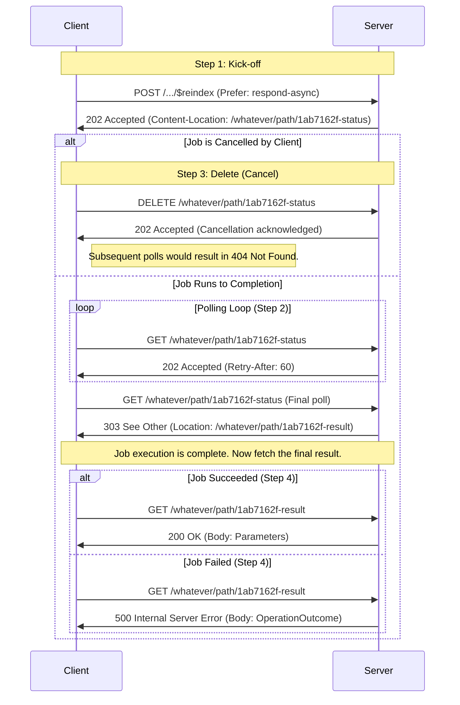

> **Implementation Note:**
> The FHIR Asynchronous Interaction Request Pattern is under active development. This page replaces the
> Bundle-based pattern published in [FHIR R5](https://hl7.org/fhir/R5/async-bundle.html); see the
> [Migration Notes](#migration-notes) below. Participate in design discussions at
> [chat.fhir.org](https://chat.fhir.org/#narrow/channel/179166-implementers/topic/Async.20interaction.20pattern).

### Use Case

All interactions defined in the [RESTful API](https://hl7.org/fhir/http.html) are synchronous by default. For
interactions that may require significant processing time, servers can offer an asynchronous mode so the client
does not need to wait for a response.

This pattern, based on [RFC 7240](https://tools.ietf.org/html/rfc7240#section-4.1), applies to
[Operations](https://hl7.org/fhir/operations.html) and [Defined Interactions](https://hl7.org/fhir/http.html)
that a server elects to process asynchronously.

For example, an operation like `$reindex`, which might be used to process millions of `Observation` resources
against a new `SearchParameter`, is an ideal candidate for this pattern. A synchronous request would likely time
out, but an asynchronous request allows the client to submit the job and check on its status later. The final
result of a successful `$reindex` operation is typically a `Parameters` resource summarizing the outcome.

#### Related Pattern: Asynchronous Bulk Data Request

For exporting bulk/large result sets (e.g., all `Patient` resources), see the
[Asynchronous Bulk Data Request](async-bulk.html) pattern. When the `_outputFormat` parameter is present in a
request, the Bulk Data pattern SHALL be used. (See [Design Questions Under Discussion](#design-questions-under-discussion)
regarding this disambiguation rule.)

### Visual Overview: Sequence Diagram

This diagram shows the complete lifecycle of an asynchronous request, including the paths for a job that is
cancelled versus one that runs to completion, and the outcomes for a completed job that either succeeds or fails.



### 1. Kick-off Request

The kick-off request uses the same HTTP method, URL, and body as the corresponding synchronous interaction, but
adds a `Prefer` header to signal the asynchronous request.

> **Note on URLs in Examples:** Throughout this specification, example URLs use paths like
> `/whatever/path/1ab7162f-status` and `/whatever/path/1ab7162f-result` for clarity. Servers may choose any URL
> structure for status and result endpoints. Clients must treat all URLs returned by the server (in
> `Content-Location` and `Location` headers) as opaque values and should not parse or construct them.

#### Headers

*   **`Accept`** (string)
    *   Specifies the format for any resource returned in the kick-off response (such as an informational or
        error `OperationOutcome`). A client SHOULD provide this header. If omitted, the server MAY choose a
        format or return an error.
*   **`Prefer`** (string, **required**)
    *   Must be set to `respond-async` to request asynchronous processing.

#### Header Scope

Headers on each request in this pattern apply only to that request's response: the kick-off request's headers
govern the kick-off response, a status request's headers govern that status response, and the final result
request's headers govern the result response. This separation allows different content negotiation for status
versus result responses and eliminates ambiguity about which response a header applies to.

#### Example: Kicking off a `$reindex` Operation

Here, the client asks the server to re-index all `Observation` resources for a new search parameter.

```
POST /fhir/Observation/$reindex HTTP/1.1
Host: fhir.example.com
Accept: application/fhir+json
Prefer: respond-async
Content-Type: application/fhir+json

{
  "resourceType": "Parameters",
  "parameter": [
    {
      "name": "url",
      "valueUrl": "http://example.org/fhir/SearchParameter/observation-special-code"
    }
  ]
}
```

#### Response - Success

If the server accepts the job, it returns `202 Accepted` with a `Content-Location` header pointing to a status
polling URL.

*   **HTTP Status Code:** `202 Accepted`
*   **`Content-Location`:** An absolute URL for polling the job's status.
*   **Body (Optional):** An `OperationOutcome` or other resource with informational details.

#### Example: Server Response for `$reindex` Kick-off

```
HTTP/1.1 202 Accepted
Content-Location: https://fhir.example.com/whatever/path/1ab7162f-status
Content-Type: application/fhir+json

{
  "resourceType": "OperationOutcome",
  "issue": [{
    "severity": "information",
    "code": "informational",
    "details": { "text": "Re-indexing job accepted and is now in progress." }
  }]
}
```

#### Response - Error

If the server rejects the request (e.g., due to invalid parameters or lack of permissions), it returns a
standard `4XX` or `5XX` error.

*   **HTTP Status Code:** `4XX` or `5XX`
*   **Body:** An `OperationOutcome` explaining the error.

### 2. Status Request (Polling)

Clients poll the URL from the `Content-Location` header using an HTTP `GET` to check the job's status. Clients
SHOULD implement an [exponential backoff](https://en.wikipedia.org/wiki/Exponential_backoff) strategy.

Servers SHOULD include a [`Retry-After`](https://developer.mozilla.org/en-US/docs/Web/HTTP/Headers/Retry-After)
header (in seconds or as an HTTP-date) to guide the client's polling frequency. If a client polls too
frequently, the server SHOULD return `429 Too Many Requests`.

#### Response - In Progress

While the job is still running, the server responds with `202 Accepted`.

*   **HTTP Status Code:** `202 Accepted`
*   **Headers:**
    *   `Retry-After`: (Optional) Suggests when to make the next request.
    *   `X-Progress`: (Optional) A short string describing the current progress (e.g., "55% complete").
*   **Body (optional):** A `Parameters` or other resource with informational details. Semantics of interim
    bodies are implementation-defined; standardized interim/partial result reporting is under discussion as a
    future extension.

#### Example: In-Progress Poll for `$reindex`

```
GET /whatever/path/1ab7162f-status HTTP/1.1
Host: fhir.example.com
Accept: application/fhir+json
```

```
HTTP/1.1 202 Accepted
Retry-After: 60
X-Progress: Indexed 550,000 of 1,200,000 resources.
```

#### Response - Complete

When the job is finished (whether it succeeded or failed), the server responds with `303 See Other`. The
`Location` header points to the final result.

*   **HTTP Status Code:** `303 See Other`
*   **Headers:**
    *   `Location`: The absolute URL of the final result resource or endpoint.
*   **Body:** Body is empty. The final result must be fetched from the `Location` URL.

Note that the status endpoint reports only on the *polling machinery*, not on the outcome of the job: a job that
failed during execution still completes, so the status endpoint still returns `303 See Other`, and the failure
is conveyed by the result endpoint (see [Fetch the Result](#4-fetch-the-result)). A status code other than
`202` or `303` from the status endpoint indicates a problem with the status endpoint itself (e.g., a transient
infrastructure error), which clients MAY retry.

#### Example: Completed Poll for `$reindex`

```
GET /whatever/path/1ab7162f-status HTTP/1.1
Host: fhir.example.com
Accept: application/fhir+json
```

```
HTTP/1.1 303 See Other
Location: https://fhir.example.com/whatever/path/1ab7162f-result
```

### 3. Delete Request (Cancel)

Servers SHOULD support cancellation. The client MAY send an HTTP `DELETE` to the polling URL to request
cancellation of the job. On success, the server SHOULD clean up any associated data. Subsequent polls to this
URL MUST return `404 Not Found`.

#### Response - Success

*   **HTTP Status Code:** `202 Accepted`
*   **Body (Optional):** An `OperationOutcome`.

#### Example: Cancelling the `$reindex` Job

```
DELETE /whatever/path/1ab7162f-status HTTP/1.1
Host: fhir.example.com
```

```
HTTP/1.1 202 Accepted
Content-Type: application/fhir+json

{
  "resourceType": "OperationOutcome",
  "issue": [{
    "severity": "information",
    "code": "informational",
    "details": { "text": "Job cancellation requested." }
  }]
}
```

### 4. Fetch the Result

After receiving a `303 See Other` from the polling URL with a `Location` header, the client performs a final
`GET` against that `Location` URL to retrieve the outcome of the operation.

The response from this final `GET` is **exactly what the synchronous interaction would have returned**. This
includes the status code (e.g., `200 OK` for success, `422 Unprocessable Entity` for a business rule error),
standard headers (`ETag`, `Last-Modified`), and the body (e.g., a `Parameters` resource for an operation, a
resource for a create, a `Bundle` for a search).

Servers SHOULD document or communicate how long results remain available after completion (e.g., via an
`Expires` header on the result response or in server documentation). Operation definitions and implementation
guides MAY impose minimum retention requirements.

#### Example: Fetching the Successful `$reindex` Result

The client fetches the result and receives the final `Parameters` resource indicating success.

```
GET /whatever/path/1ab7162f-result HTTP/1.1
Host: fhir.example.com
Accept: application/fhir+json
```

```
HTTP/1.1 200 OK
Content-Type: application/fhir+json; charset=utf-8
ETag: W/"1ab7162f-final"
Last-Modified: Fri, 01 Mar 2024 14:05:10 GMT

{
  "resourceType": "Parameters",
  "parameter": [
    {
      "name": "status",
      "valueCode": "completed"
    },
    {
      "name": "durationInSeconds",
      "valueDecimal": 742.5
    },
    {
      "name": "resourcesScanned",
      "valueUnsignedInt": 1200000
    },
    {
      "name": "indexEntriesCreated",
      "valueUnsignedInt": 1457890
    },
    {
      "name": "processingSummary",
      "part": [
        {
          "name": "resourcesIndexedSuccessfully",
          "valueUnsignedInt": 1198540
        },
        {
          "name": "resourcesSkippedNoMatchingPath",
          "valueUnsignedInt": 1458
        },
        {
          "name": "resourcesSkippedWithError",
          "valueUnsignedInt": 2
        }
      ]
    },
    {
      "name": "message",
      "valueString": "Re-indexing complete. 2 resources failed validation and were skipped."
    }
  ]
}
```

#### Example: Fetching a Failed `$reindex` Result

If the re-indexing job failed internally, the final result is an error. The polling response would still be
`303 See Other` (because the job has *completed*), but fetching the result reveals the failure.

```
GET /whatever/path/1ab7162f-result HTTP/1.1
Host: fhir.example.com
Accept: application/fhir+json
```

```
HTTP/1.1 500 Internal Server Error
Content-Type: application/fhir+json; charset=utf-8

{
  "resourceType": "OperationOutcome",
  "issue": [{
    "severity": "error",
    "code": "exception",
    "details": { "text": "Job failed due to an unexpected database connection error during indexing." }
  }]
}
```

### Security Considerations

Status and result URLs identify a specific job and its output, which may include sensitive data. Even though
these URLs are opaque, servers SHALL apply the same access control to status and result requests as they would
to the corresponding synchronous interaction, and SHOULD limit access to the client (or authorization context)
that initiated the job.

### Migration Notes

This pattern replaces the Bundle-based Asynchronous Interaction Request Pattern published in
[FHIR R5](https://hl7.org/fhir/R5/async-bundle.html), in which a completed job returned `200 OK` with the result
wrapped in a `batch-response` Bundle. The redirect-based design avoids two ambiguities in the earlier pattern:

*   **Error ambiguity:** Under the earlier pattern, an error status code from the status endpoint could mean
    either "the polling mechanism failed" or "the job failed." Here, the status endpoint reports only on
    polling, and job outcomes — including failures — are conveyed with full HTTP semantics by the result
    endpoint.
*   **Header scope ambiguity:** Under the earlier pattern, request headers such as `Accept` could ambiguously
    apply to the status response or to the wrapped final result. Here, each request's headers govern only that
    request's response.

It also removes the Bundle wrapper, so results that are not naturally Bundles (e.g., a `Parameters` resource
from `$reindex`) are returned directly, and a result that *is* a Bundle is not nested inside another Bundle.

Systems that require the R5 behavior can continue to cite the published R5 pattern. A `Prefer` extension token
(e.g., `async-mode=bundle|redirect`) has been proposed to let servers offer both behaviors during migration;
this is under discussion and not yet part of this specification.

### Design Questions Under Discussion

1.  **What errors are synchronous vs. asynchronous?**
    *   Minimal answer: invalid input or authorization problems are returned synchronously as `4XX`/`5XX` at
        kick-off. Otherwise the request is accepted with `202` and runtime failures surface at result time.
2.  **How do clients know an operation supports async?**
    *   Minimal answer: clients send `Prefer: respond-async`; if unsupported, the server returns `400`.
        In FHIR R6, [`OperationDefinition.synchronicity`](https://hl7.org/fhir/operationdefinition.html)
        (`synchronous | asynchronous | either`) declares an operation's behavior, and operation definitions can
        describe asynchronous support in human-readable documentation.
    *   Richer answer: define discovery features (e.g., via the Application Feature framework) to indicate
        async behavior (allowed | required | ...) per operation or interaction.
3.  **Pattern disambiguation:** whether `_outputFormat` should remain the trigger that selects the
    [Asynchronous Bulk Data Request](async-bulk.html) pattern ([FHIR-50598](https://jira.hl7.org/browse/FHIR-50598)).
4.  **Interim results:** standardized semantics for bodies returned with `202` polling responses (e.g., marking
    a subset of output parameters as available before completion).
5.  **Job discovery:** integration with the `Task` resource (e.g., returning a task ID at kick-off so running
    jobs can be discovered by search) is deferred to future work.
